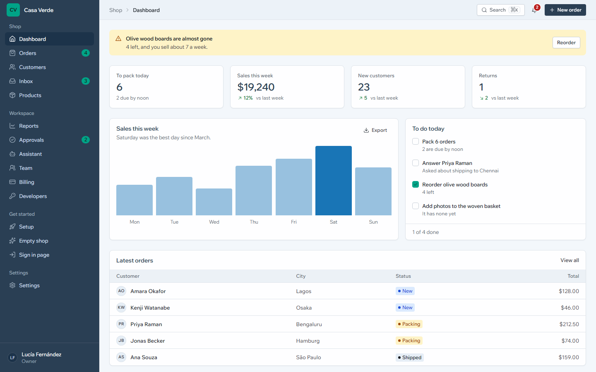
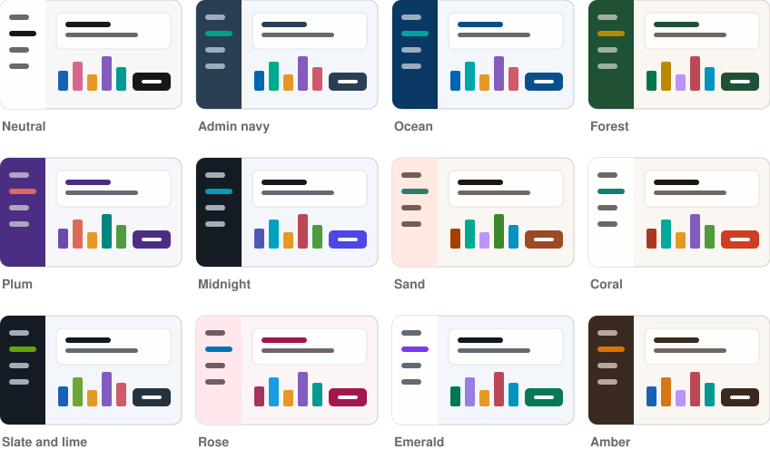
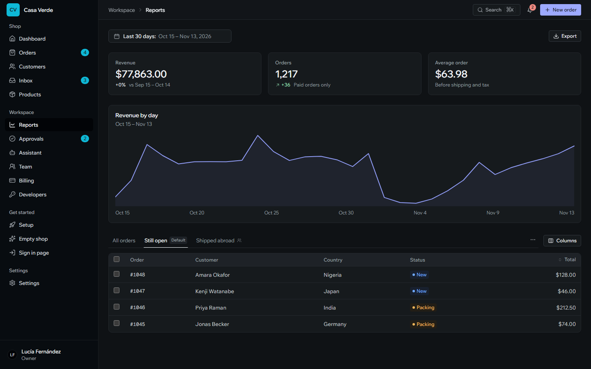
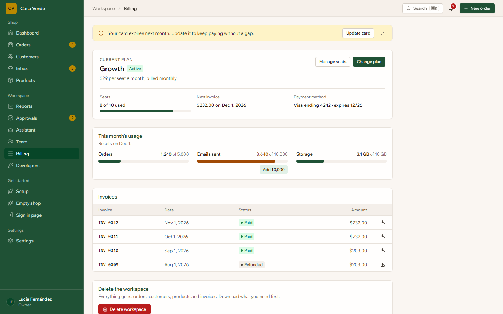
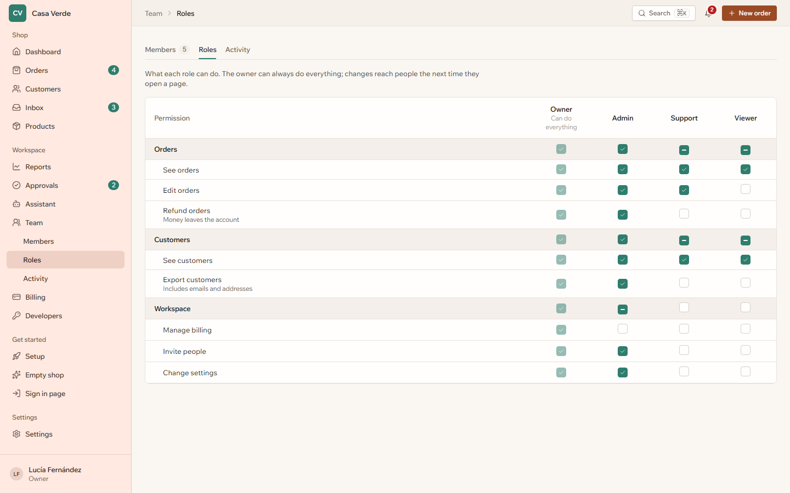

<div align="center">

<a href="https://syvna.com">
  <picture>
    <source media="(prefers-color-scheme: dark)" srcset=".github/assets/logo-dark.svg">
    
  </picture>
</a>

### The components every Syvna app is built from.

Dashboards, websites and AI agents, from one library: themed by tokens, in any palette, light or dark.<br>
Built so people and agents can both build with it.

[**syvna.com**](https://syvna.com) · [Changelog](CHANGELOG.md) · [Releases](https://github.com/ValeBytes/syvna_ui_sdk/releases) · [How it's built](AGENTS.md)

[](https://github.com/ValeBytes/syvna_ui_sdk/actions/workflows/ci.yml)
[](https://github.com/ValeBytes/syvna_ui_sdk/releases)

<br>



</div>

<br>

## What's inside

**126 components** in three kits, each with a live playground, a guide and every prop documented.

| Kit | For | Some of what's in it |
|---|---|---|
| **Dashboard** | the screens of a business app | app shell and 21 sidebars, tables with saved views and bulk actions, date ranges with comparison, tag, number and currency inputs, permissions, audit log, billing, usage, invites, approvals |
| **Website** | landing pages and shops | headers, heroes and pricing tables in 21 variants each, features, testimonials, FAQ, product cards, cart and checkout |
| **Agent** | working with AI agents | the conversation and prompt box, plans, tool calls, reasoning, sources, approvals, questions, and a chooser that previews other looks for a part of the screen |

Every screen in this README is a real template from the docs site, not a mock-up.

## Any palette, not just light and dark

A palette is made from a few seed colours: a brand, an accent, how the sidebar looks and how the greys lean. Everything else, light and dark, is worked out in OKLCH and checked for contrast, so text stays readable whatever the colours. Twelve are ready-made; agents make new ones from a brand's colours.



```tsx
import { PaletteStyle } from "@syvna/ui";

<PaletteStyle preset="forest" />
// or your own
<PaletteStyle seed={{ brand: "#0f766e", accent: "#f59e0b", chrome: "dark", neutral: "warm" }} />
```

<table>
  <tr>
    <td width="50%"><br><sub><b>Reports</b> · Midnight, dark</sub></td>
    <td width="50%"><br><sub><b>Billing</b> · Forest</sub></td>
  </tr>
  <tr>
    <td width="50%"><br><sub><b>Roles and permissions</b> · Sand</sub></td>
    <td width="50%">
      <b>Made for agents too</b><br><br>
      An MCP server lets an AI find the right component, read its props and guide, pick or make a palette, and check what it wrote against the design before anyone sees it.<br><br>
      <code>list_components</code> · <code>search_components</code> · <code>get_component</code> · <code>get_variants</code> · <code>list_palettes</code> · <code>make_palette</code> · <code>check_code</code>
    </td>
  </tr>
</table>

## Use it in an app

Copy in only the components an app needs, at a release. The app owns the code and ships nothing it doesn't use:

```bash
npx github:ValeBytes/syvna_ui_sdk#v0.2.0 init
npx github:ValeBytes/syvna_ui_sdk#v0.2.0 add Button DateRangePicker PaletteStyle
```

Later, `npx github:ValeBytes/syvna_ui_sdk upgrade` moves the app to the newest release and keeps any file the app has changed.

## Work on it

```bash
npm install
npm run dev        # the docs, with a playground per component and the templates: http://localhost:4500
npm run typecheck
npm run registry   # rebuild the catalogue and the copy-in registry after changing components
```

The layout, the rules for components and screens, and how releases work: [AGENTS.md](AGENTS.md). Releases are git tags (`vX.Y.Z`) with notes in [CHANGELOG.md](CHANGELOG.md):

```bash
npm run release -- minor
git push origin main --follow-tags
```

<br>

<div align="center">
  <sub>Built by <a href="https://syvna.com">Syvna</a>.</sub>
</div>
